<h1>civ-atlas · 多 Agent 沙盒</h1>

> 给 [civ-atlas](https://github.com/guaner-334/civ-atlas) 的星球历史推演加一层「可被 AI 接管」的沙盒：MCP 工具层、AI 君主回合、小事件裁决层、可配置场与地块级演化、本地浏览器查看器。

[](LICENSE)


[](https://github.com/guaner-334/civ-atlas)

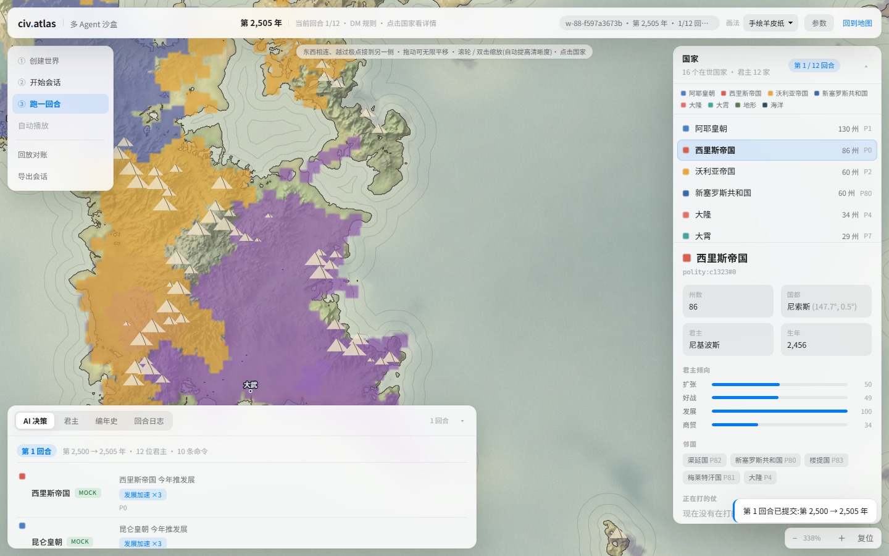

<sub>本页图片均为程序模拟生成的地图，不是真实地图。</sub>

## 这是什么

上游 civ-atlas 是纯前端的世界生成 + 历史推演网站。这个仓库在它之上加了一层**无头、可编排、可 AI 接管**的沙盒：

- 不重写引擎：所有扩展都在编排层，通过「停止推演 → 下命令 → 接着推」的 `play` API 完成。
- 引擎确定性不破：同一世界 + 同一命令史 = 逐字节一致的结果（21 组指纹对账全过）。
- 全程可回放：AI 下的每一道命令都进命令史，`civ_session_verify` 能重推对账。

## 新增了什么

| 模块 | 内容 |
|---|---|
| **MCP 工具层**（`mcp/tools.ts`、`mcp/server.ts`） | 零依赖 JSON-RPC stdio 服务，21 个 `civ_*` 工具：建世界、开会话、下单、推演、编年史、导出、回放对账、君主回合、DM 小决策、小事件裁决、场目录 |
| **AI 君主**（`mcp/monarch.ts`、`mcp/prompt.ts`、`mcp/llm.ts`） | 每个国家先拿简报，再由 LLM（或 mock）决定命令；每国每回合最多 3 条，编译成引擎命令后统一推演；支持 DeepSeek / 百炼 / 自定义 OpenAI 兼容 |
| **小事件裁决层**（`mcp/petty*.ts`） | 接官方 Jev `POST /api/v1/decisions`；客户端控 token（≤4250）、严格串行优先队列（P0/P1/P2）、超时/背压/熔断/降级，概率交给引擎统一随机流抽样 |
| **DM 小决策与故事**（`mcp/dm.ts`、`src/gen/civ/storyEngine.ts`） | 天灾/小贸易真写进引擎；`story` 干预让 DM 按剧情写事件，效果只落在城市折损、人口上限、发展、叙事四类 |
| **开局定制与君主机制**（`mcp/monarch-start.ts`、`mcp/tuning.ts`、`mcp/viewer/start-custom.js`、`mcp/viewer/region-picker.js`） | 开局设国家数量 / 控制方式、增删国家与君主、在地图上连续点选疆域；角色卡可由生平推断性格（LLM 或规则回退）、设种族与寿命；君主每回合按步长算行动点（AP），可培养后代 / 亲征 / 派兵 / 巡抚，按寿命自然死亡并由后代继位 |
| **DM 上帝视角硬命令**（`mcp/player-commands.ts`、`mcp/viewer/dm-chat.js`） | 推演中用自然语言对任意国家下硬命令（须点名国家），可排队 / 撤销、有每回合上限；没有「玩家自己的国家」这个概念 |
| **地形渲染**（`mcp/terrain.ts`、`mcp/map-pool.ts`） | 直接复用主站的 `src/gen/raster.ts`、`src/gen/rasterWindow.ts`、`src/render/fantasy.ts|realistic.ts` 生成底图、放大块与矢量细节层；零新依赖，PNG 仍由 `mcp/png.ts` 手写编码 |
| **多画风统一河网**（`mcp/rivers-data.ts`、`mcp/viewer/vec-draw.js`） | 复用上游 `src/gen/riverGeometry.ts`，每个世界只算一次河网并裁到陆地、RDP 抽稀，随 `/api/map/vectors` 下发；手绘 / 地理 / 卫星 / 白模共用同一份几何，只换配色与线宽 |
| **浏览器查看器**（`mcp/viewer.ts` + `mcp/viewer/`） | 由 `scripts/lib/sandboxViewer.ts` 挂到主站同一个开发服务器（`/sandbox/`）：主站同款地形画法与矢量墨线、放大现算高清块、跨极无限拖动；还有**白模**画法与魔力层自定义色带；国家详情/AI 决策/编年史/回合日志/回放对账/导出，含 DM、小事件、场图层与 hover 精确值 |
| **可配置场**（`src/gen/civ/fieldPlugin.ts`） | 玩家给一份 spec 就能生成一组原生插件表：自己选密度、扩散、衰减、强度，以及影响哪些官方数值（`city.capacity`/`war.odds`/`unrest.add` 等 6 个口） |
| **地块级场** | `unit: "tile"` 时场按世界全部地块逐年演化，出手前聚合成州值再影响引擎；图层内存按地块、存档按 `cell` 层 |
| **官方 .civplugin 加载器**（`mcp/plugin-loader.ts`） | 在 MCP 的 CommonJS 产物里用 QuickJS 直装官方推演插件（文件或源码目录，最多 4 个），与内置场并列 |
| **魔力动态场**（`src/gen/civ/magicPlugin.ts`） | 内置示例插件：魔脉按地块扩散渗流，每 100 年一帧，按州聚合成城市容量；强度 0 时官方指纹逐字节不变 |
| **君主沙盒四功能** | 首次引导（LLM/Jev 两把 Key 落盘本机）、双开关（LLM 扮演 / Jev 判断独立）、君主角色卡 + 独立记忆 + 高影响命令 Jev 审核 + DM / 复核者、分层提示词（稳定前置）+ 逐州属性 + 渗透情报（第 27 种干预 `intel`，进命令史） |

更多细节在 [`mcp/README.md`](mcp/README.md)。

## 快速开始

需要 Node.js 22+（`package.json` 的 `engines`，CI 用 Node 24）与 pnpm。Windows 本机没装 pnpm 也能跑：双击 [`启动.bat`](启动.bat) 会直接用 `node_modules` 里的 Vite 起服务，细节见 [`本地运行说明.md`](本地运行说明.md)。

### 1. 跑原版网站

```bash
pnpm install
pnpm dev          # http://127.0.0.1:5188
```

Windows 下也可以双击根目录的 [`启动.bat`](启动.bat)。

### 2. 构建 MCP 工具层

```bash
# 本机没有 pwsh 可执行文件时用 powershell 调脚本（等价于 pnpm mcp:build）
powershell -NoProfile -ExecutionPolicy Bypass -File mcp/build.ps1
```

构建产物在 `mcp/.build/`，把 MCP 客户端指向 `mcp/.build/mcp/server.js`：

```json
{
  "mcpServers": {
    "civ-atlas": {
      "command": "node",
      "args": ["<仓库路径>/mcp/.build/mcp/server.js"]
    }
  }
}
```

### 3. 跑查看器

```bash
pnpm dev          # http://127.0.0.1:5188
# 沙盒监视台在同一个服务器上:http://127.0.0.1:5188/sandbox/
```

同一个开发服务器下就能打开两份界面:主站在 `/`,沙盒在 `/sandbox/`(首页左下角也有入口)。这一层由 `scripts/lib/sandboxViewer.ts` 这个 Vite 插件挂载(只在 `serve` 时生效,生产构建里没有);首次打开 `/sandbox/`、或 `mcp/` 与 `src/` 下被编译源码的内容指纹有变化时,它会自动构建 MCP 层并反代 `/sandbox/*` 与 `/api/*`,不用再单开一个 5190(指纹记在 `mcp/.build/source.fingerprint`,不提交)。

第一次打开 `/sandbox/` 会先弹一个引导浮层:**LLM(扮演君主)** 与 **Jev(裁决小事件 / 审核高影响命令)** 两把 Key 分开填,都能「测试连接」;不想联网就点「稍后配置」,自动切到 mock。Key 按你的选择存在本机浏览器的 `localStorage`(明文,只在本机),只 POST 给 `127.0.0.1` 上的监视台进程,不进会话日志、不进导出;公用电脑建议直接用 mock。

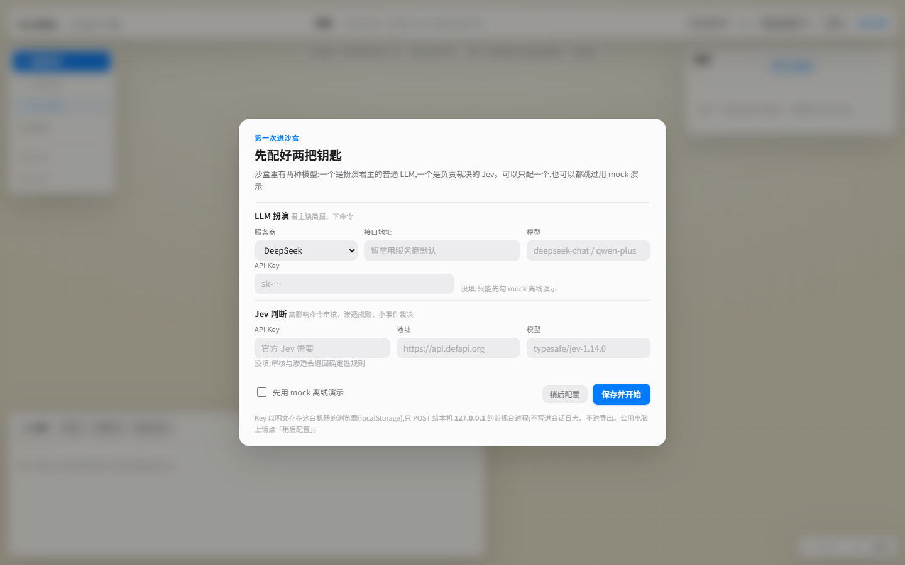

「参数」抽屉里有两个互不依赖的开关——**LLM 扮演** 与 **Jev 判断**,四种组合都能跑:只开 LLM(君主回合 + 规则审核)、只开 Jev(小事件回合)、两个都开(小事先结算,高影响命令再过 Jev)、两个都关(纯引擎推演)。另有 **DM / 复核者**:打开后「跑一回合」只出方案不推演,可以在面板里逐条取消命令再提交。这里没有「玩家自己操作一个国家」的设定,DM 是上帝视角,可对任意国家下命令。


监视台的地图现在**和主站同一套渲染管线**,不再另写一份栅格与配色:

- **画法**:顶栏「画法」可选 **手绘羊皮纸(fantasy) / 卫星写实(satellite) / 地理图(geo) / 白模(white)**,另有改造前的沙盒底图(classic)作对照;白模下地形只剩灰白浮雕,方便分辨魔力 / 疆域 / 场层。底图由 `src/gen/raster.ts` + `src/render/fantasy.ts|realistic.ts` 在 Node 里直接算出来(这些模块本来就是「纯计算,worker / Node 都能跑」),加了世界时只算一次并缓存。
- **放大分辨率**:底图是 1 倍主图(2048 × 1024)。放大超过 2 倍后按 √2 分档、只重算屏幕上那几块(`src/gen/rasterWindow.ts` 的 `rasterizeWindow`),块坐标锚在球面展开平面上,拖动时缓存仍能复用,越放大越锐利。
- **矢量细节层**:手绘风的海岸墨线、近岸波纹、山/树符号不再烤进位图,而是由 `/api/map/vectors` 送抽稀后的折线与符号,浏览器按**固定 1–1.15px 屏幕线宽**重画——放大到 1200% 也保持细锐,符号按 `g.z` 分级出现、尺寸按 `glyphScale(k)` 收缩(和主站 `render/detail.ts` 一个思路)。跨 180° 经线的线会在另一侧补一份,拖到屏幕边缘也不会断。
- **多画风统一河网**:`mcp/rivers-data.ts` 复用上游 `src/gen/riverGeometry.ts`,每个世界只算一次河网几何,裁到陆地、RDP 抽稀后随 `/api/map/vectors` 下发;`mcp/viewer/vec-draw.js` 让四种现代画风共用这一份几何,只按画风换颜色 / 线宽 / 河岸层,所以 100% 与高倍率走线完全一致。
- **海岸线跟着瓦片走**:每块放大块由服务端按**自己的倍率**重新追一遍水陆边界(0.5 瓦片像素内,就是边界像素的量化下限),而不是复用 1 倍底图那份——后者放大后会整体偏 3~4 个屏幕像素,线"浮"在岸外。换档瞬间缺块的地方由上一档瓦片放大顶着(只差 √2 倍),不会整片糊掉再突然变清。
- **拖动 / 缩放**:事件合到 `requestAnimationFrame`、海岸线连续描边、符号整帧两条路径、瓦片盖满时不画底图、交互时按像素预算降画布分辨率,松手再恢复满分辨率。
- **跨极回环**:世界东西相连,越过南北极也按球面的真实接法接到另一侧(纬度镜像 + 经度挪半圈),所以**上下左右都能一直拖**;点选国家、hover 数值、国都标注都按同一套变换反算。
- **浮窗式界面**:顶栏、左侧行动栏、参数抽屉、国家面板、日志面板、右下缩放条都是浮在地图上的玻璃卡片,国家面板和日志面板能收起到只剩一条标题。

> 地图渲染复用上游模块时有一个构建期细节:`src/render/labels/fonts.ts` 里有一句 Vite 专属的 `import.meta.env.BASE_URL`,在 CommonJS 产物里是语法错误。`mcp/build-compat.cjs` 会在 tsc 之后把**产物**里的这一句替换掉(幂等,不改上游 `src/`),`mcp/build.ps1` 与 Vite 自动构建都会调用。CommonJS 目标下 tsc 另有 6 条既有诊断(`fonts.ts` 的 TS1343/TS2339、`selftest-monarch-sandbox.ts` 的 4 条 TS2345);`mcp/build.ps1` 只把这 6 条列为可容忍,其余任何类型错误都会打印全文并让构建失败。

也可以单独起监视台(比如不跑主站、或接到别的端口):

```bash
node mcp/.build/mcp/viewer.js --port 5190
# 浏览器打开 http://127.0.0.1:5190
```

查看器的世界/会话在内存里,关掉就没了;会话日志写在 `mcp/.runs/`,预渲染瓦片缓存写在根目录 `.runs/`,两者都在 `.gitignore` 里、不提交。改 `mcp/*.ts` 后必须重建 `mcp/.build` 才生效;只改 `mcp/viewer/*.js|css|html` 是静态直出,刷新浏览器即可。

### 4. 一个最小 AI 对局

1. `civ_world_create`（`seed` 必填，`params.cells` 可选）
2. `civ_monarch_setup`（`polities: "all"`，`mock: true` 先不联网）
3. `civ_session_open`（`worldId` + `startYear`）
4. `civ_monarch_round` 反复跑；中途 `civ_state_get` / `civ_session_verify`

想要场：`civ_session_open` 加 `fields`（可带 `"unit": "tile"`）；想要官方插件：加 `plugins`。

## 验证

仓库本身的检查按 `package.json` 的脚本走:`pnpm typecheck`(主站 + 示例插件类型检查)、`pnpm test`(`tests/` 下的 Vitest 单测)、`pnpm build`、`pnpm size` 首页下载量、`pnpm smoke` 冒烟、`pnpm stress` 压力、`pnpm test:visual` 画面回归、`pnpm test:sandbox` 插件沙箱;`.github/workflows/ci.yml` 把这些拆到多台机器上并行(单测 8 份 / 压力 4 份 / 冒烟 5 份)。

MCP 层另有 15 组自检,每条都有对应的 `pnpm mcp:selftest*` 别名:

```bash
# 15 个自检（引擎、协议、君主、press、DM、小事件、场、插件、地块场、君主沙盒四功能、瓦片海岸线）
node mcp/.build/mcp/selftest.js
node mcp/.build/mcp/selftest-protocol.js
node mcp/.build/mcp/selftest-monarch.js
node mcp/.build/mcp/selftest-press.js
node mcp/.build/mcp/selftest-dm.js
node mcp/.build/mcp/selftest-dm-oracle.js
node mcp/.build/mcp/selftest-petty-core.js
node mcp/.build/mcp/selftest-petty-oracle.js
node mcp/.build/mcp/selftest-field.js
node mcp/.build/mcp/selftest-magic.js
node mcp/.build/mcp/selftest-field-plugin.js
node mcp/.build/mcp/selftest-plugin-loader.js
node mcp/.build/mcp/selftest-tile-field.js
node mcp/.build/mcp/selftest-monarch-sandbox.js
node mcp/.build/mcp/selftest-coast.js
```

- 15 组自检全绿（含地块场 30/30、君主沙盒 45/45、瓦片海岸线 18/18）。
- 根 `tsc --noEmit` 与 `examples/plugins` 类型检查均为 0 错误；已发布的插件接口第 1 版未改动。
- 确定性指纹 21/21 一致（含改地形、干预、分段推演等 21 组，2026-11-11）。
- 查看器地图：Playwright 在 `devicePixelRatio` 1 / 1.5 下跑通 建世界 → 开会话 → 跑一回合 → 跨极点选国家 → 100% / 450% / 1200% 缩放 → 四种画法来回切；高清瓦片全部 200、无 400 / 502、无 console 错误，缩回 100% 时不再请求低档瓦片。
- 11/13–11/14 的分阶段验收（多 seed 州界线修复、多画风河网、开局定制 P0–P5 等）逐轮留在 `docs/验收-*/README.md`，每轮附回归数字、Playwright 结果与已知限制。

## 截图

**君主沙盒**

| 君主角色卡:性格 / 能力 / 自述 / 独立记忆 / 情报 | 回合方案复核:逐条取消命令再提交 |
|---|---|
| 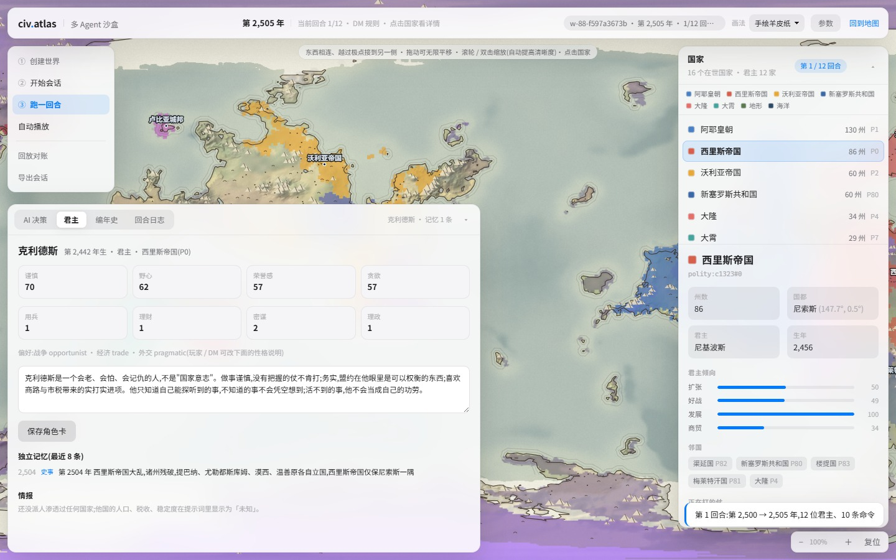 | 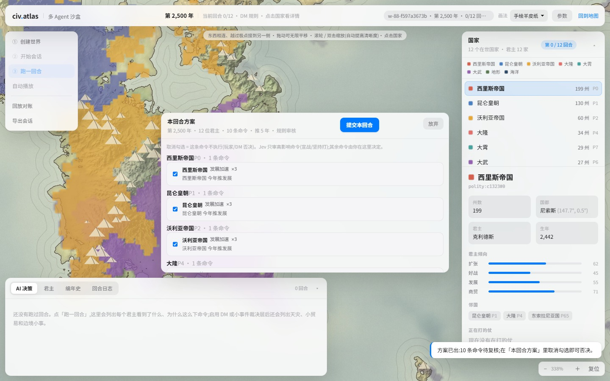 |

**场与裁决层**

| 魔力动态场 | 地块级场 |
|---|---|
| 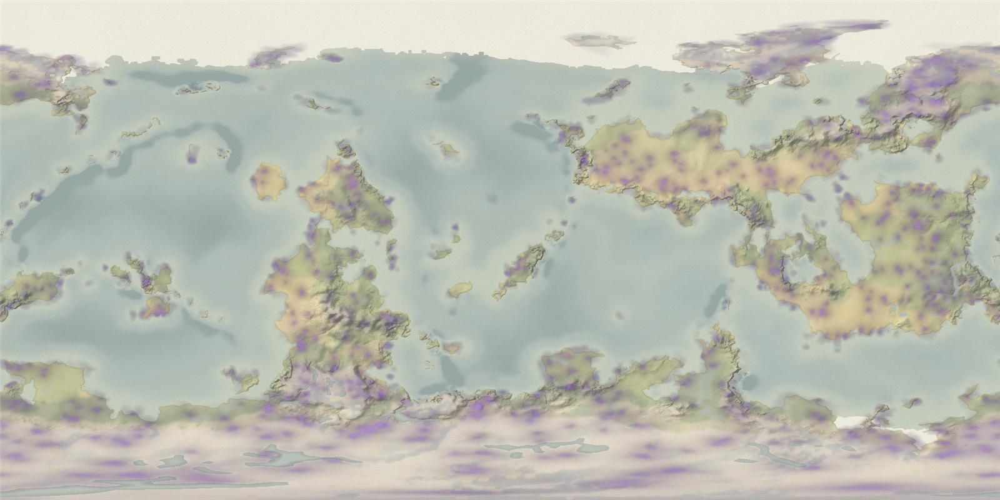 | 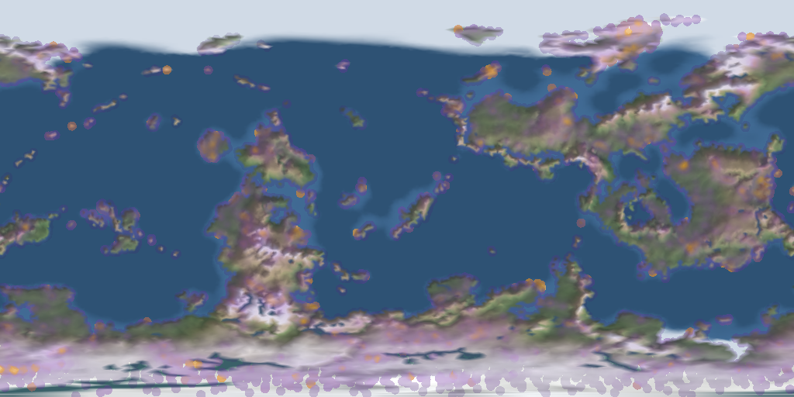 |

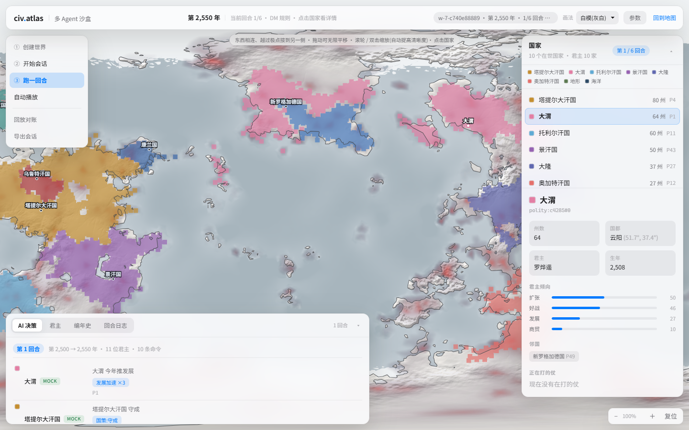

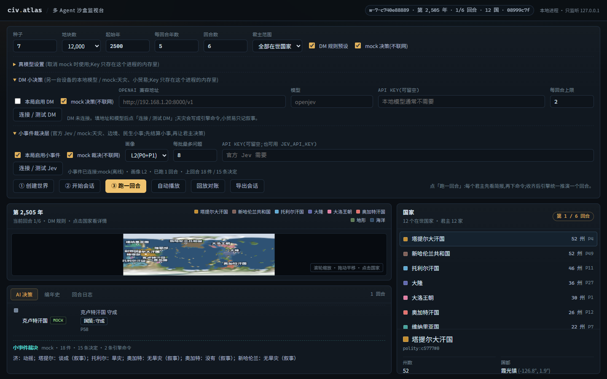

**开局定制与君主机制（2026-11-14）**

| 开局设置：在地图上连续点选疆域，已选州可逐块增减 | 君主页：行动点（AP）、君主位置与后代 |
|---|---|
| 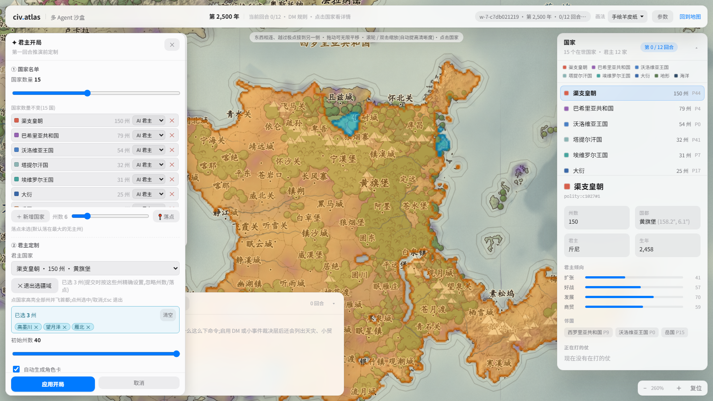 | 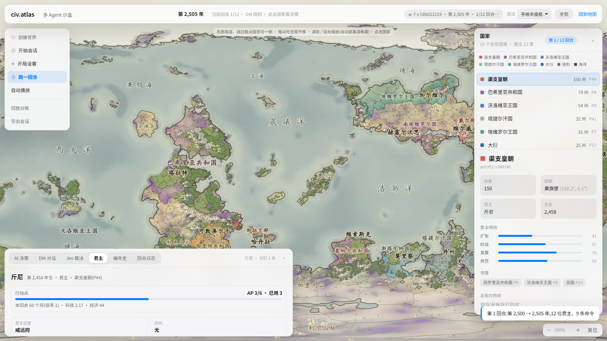 |

| DM 上帝视角硬命令：点名两国宣战，入队待执行、可撤销 | 地理图画法：四种画风共用同一份河网几何 |
|---|---|
| 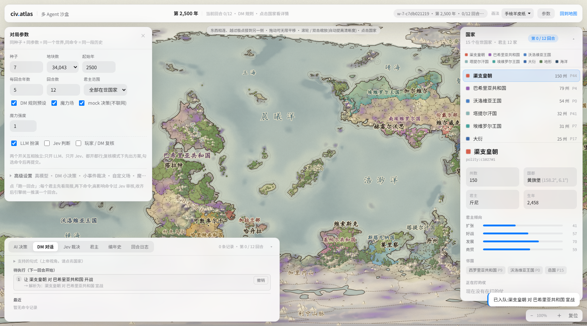 | 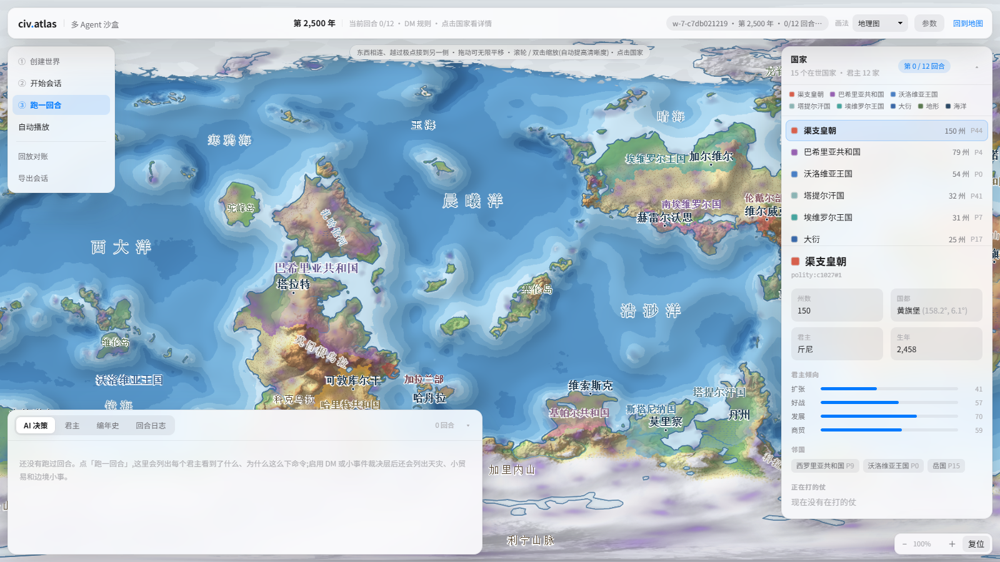 |

<sub>这四张取自 `docs/验收-2026-11-14-*` 各轮验收记录（P2 疆域点选 / P5 君主 AP / P4.5 上帝视角命令 / 第二轮多画风河网）。</sub>

## 目录

按 2026-11-15 的仓库实况整理，★ 为本 fork 在上游之外新增的部分：

```
civ-atlas/
├── src/                       上游主站（React + Vite，本次只在 gen/civ/ 内增补模块）
│   ├── gen/                   世界生成：地形、气候、栅格、存档、QuickJS 插件运行时
│   │   └── civ/               文明推演引擎与官方插件接口
│   │       ├── play.ts        「停止推演 → 下命令 → 接着推」的门面
│   │       ├── fieldPlugin.ts / magicPlugin.ts ★     可配置场 / 魔力动态场
│   │       ├── storyEngine.ts ★ / petty*.ts ★ / dm.ts ★    故事、小事件、DM 规则
│   │       └── monarch*.ts ★ / interventions.ts …           角色卡、记忆、情报、干预
│   ├── render/                主站画法、矢量细节、疆域（沙盒直接复用其中的纯函数）
│   ├── ui/ plugin/ ai/ account/ diag/    React 界面、插件沙箱、内置 AI、账号云同步
│   └── *.worker.ts            各类 Web Worker
├── mcp/ ★                    无头工具层（Node，CommonJS 产物在 mcp/.build/）
│   ├── server.ts / tools.ts / engine.ts     JSON-RPC stdio 服务 / 21 个 civ_* 工具 / 会话门面
│   ├── monarch*.ts / prompt.ts / llm.ts     AI 君主、简报、分层提示词、LLM 客户端
│   ├── petty*.ts / dm.ts / intel.ts         小事件裁决、DM 小决策、渗透情报
│   ├── terrain.ts / map-pool.ts / png.ts / rivers-data.ts / coast-trace.ts    底图、瓦片、河网、海岸线
│   ├── player-commands.ts / plugin-loader.ts / tuning.ts     DM 硬命令、官方插件加载、数值
│   ├── viewer.ts + viewer/    监视台服务端与浏览器页面（app.js、style.css、vec-draw.js …）
│   ├── selftest*.ts           15 组 Node 自检
│   ├── build.ps1 / build-compat.cjs / tsconfig.build.json    构建与 Vite 语法补丁
│   └── .build/ .runs/         构建产物 / 会话日志（不提交）
├── scripts/                   上游构建与检查脚本
│   ├── lib/sandboxViewer.ts ★    把 /sandbox/ 挂到 vite 单端口 5188
│   └── lib/sandbox/ …         沙盒检查页、假 AI 服务等
├── tests/                     上游 Vitest 单测（数百个 .test.ts）
├── public/                    静态资源：字体、肖像、指南 / 隐私 / 条款页
├── docs/                      开发文档、截图、验收记录
│   ├── plugins/               官方插件接口文档（api / map / sim / layer-format / limits / package）
│   ├── screenshots/           README 与各验收文档引用的截图
│   ├── 验收-2026-11-*/ ★      分阶段验收（多 seed 修复、河网、P0–P5 …）
│   └── 交接-当前状态与待办.md / 君主沙盒-四功能可行性报告.md / development.md
├── examples/plugins/          10 个官方格式 .civplugin 示例 + .d.ts 接口
├── ai-ruler/ ★               「AI 扮演统治者」独立原型（已归档的本地实验，简报 → 决策 → 命令，含 mock）
├── .github/workflows/         部署与 CI（ci.yml 把单测 / 压力 / 冒烟分片并行）
├── 根目录文件
│   ├── index.html / vite.config.ts / tsconfig.json / package.json    主站与构建配置
│   ├── sandbox-check.html     插件隔离自检页（pnpm test:sandbox）
│   ├── 启动.bat / 本地运行说明.md    Windows 一键起服务与排障
│   ├── 多Agent沙盒-改造计划.md       这次改造的设计与分阶段计划
│   ├── UPSTREAM.md            上游 civ-atlas 原 README
│   ├── CONTRIBUTING.md        参与方式（暂不接受外部 PR）
│   └── README.md / LICENSE    本页 / AGPL-3.0
└── .runs/ .tmp/ .baseline/    预渲染瓦片缓存 / 临时文件 / 基线（均不提交）
```

## 文档

- [`mcp/README.md`](mcp/README.md)：MCP 工具、AI 君主、DM/小事件、场系统、插件加载器、查看器的详细用法与边界
- [`多Agent沙盒-改造计划.md`](多Agent沙盒-改造计划.md)：三阶段改造的目标、约束、验收标准
- [`docs/交接-当前状态与待办.md`](docs/交接-当前状态与待办.md)：三层架构、地块数据模型、已知问题与待办（接手前先读这一份）
- [`docs/验收-2026-11-14-P5/README.md`](docs/验收-2026-11-14-P5/README.md) 及 `docs/验收-*/`：11/13–11/14 各阶段验收记录（多 seed 修复、河网、开局定制 P0–P5），每轮含回归数字、截图与已知限制
- [`docs/君主沙盒-四功能可行性报告.md`](docs/君主沙盒-四功能可行性报告.md)：四项功能（引导 / 双开关 / 角色卡 / 提示词与情报）的实现方案、难度评级与风险点
- [`docs/plugins/README.md`](docs/plugins/README.md)：官方推演 / 地图插件接口（api、sim、map、layer-format、limits、package）
- [`本地运行说明.md`](本地运行说明.md) 与 [`启动.bat`](启动.bat)：Windows 一键起服务与排障
- [`ai-ruler/README.md`](ai-ruler/README.md)：AI 统治者原型（**已归档的本地实验**，可先不接 MCP 单独跑；见文件内的归档说明）
- [`docs/development.md`](docs/development.md)：上游的引擎开发说明
- [`UPSTREAM.md`](UPSTREAM.md)：上游原版 README；[`CONTRIBUTING.md`](CONTRIBUTING.md)：参与方式

## 许可与致谢

- 本项目基于 [guaner-334/civ-atlas](https://github.com/guaner-334/civ-atlas)（AGPL-3.0），保留其全部历史与许可证。
- 本仓库的修改同样以 **AGPL-3.0** 发布；如果把它改完挂到网上给别人用，需要按 AGPL 公开修改。
- 引擎、星球生成、历史推演、原网站的所有功劳归上游作者与贡献者；这里新增的是多 Agent 编排、场系统、查看器与工具层。
- 参与方式见 [`CONTRIBUTING.md`](CONTRIBUTING.md)：目前不接受外部代码的合并请求，问题与建议走 issue。
- 仓库里没有任何真实 API Key：MCP 侧 Key 只从工具参数或环境变量进内存；查看器按需把 Key 存在本机浏览器的 `localStorage`（明文，只在本机），只 POST 给 `127.0.0.1` 的监视台，不进会话日志、不进导出。
