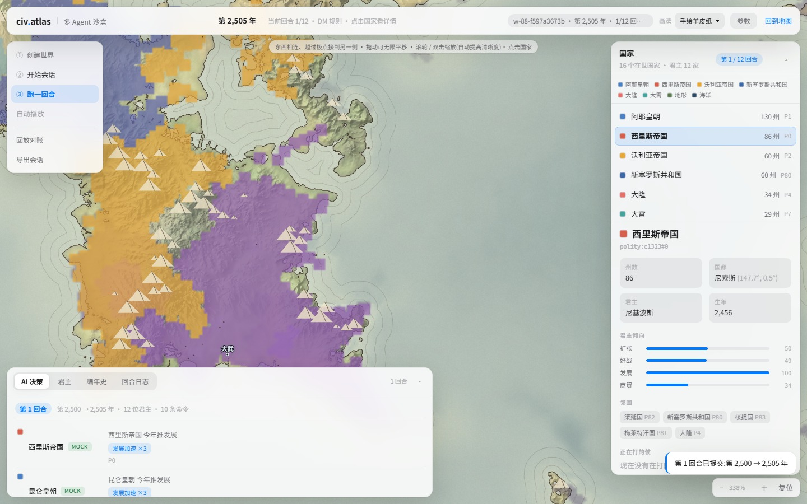
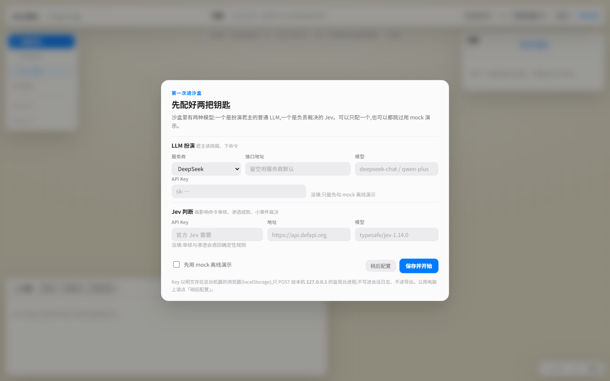
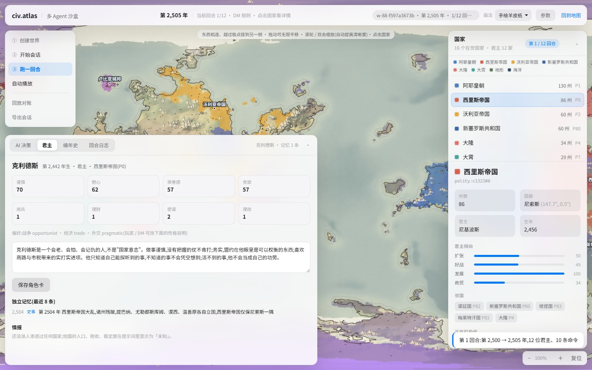
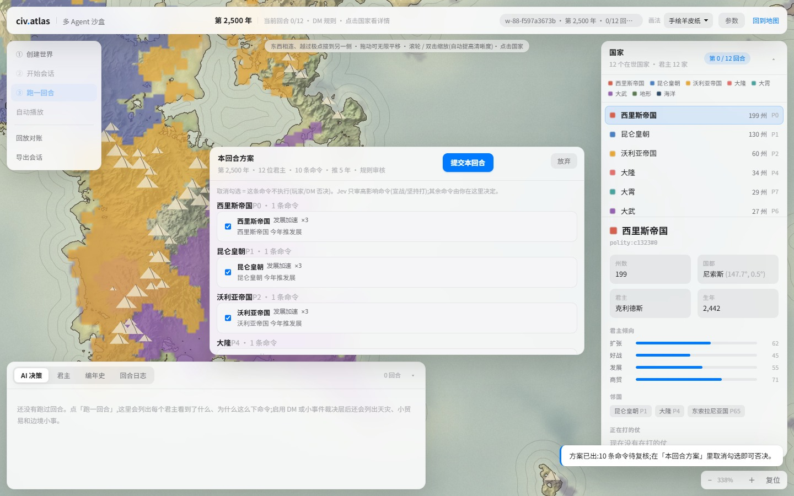
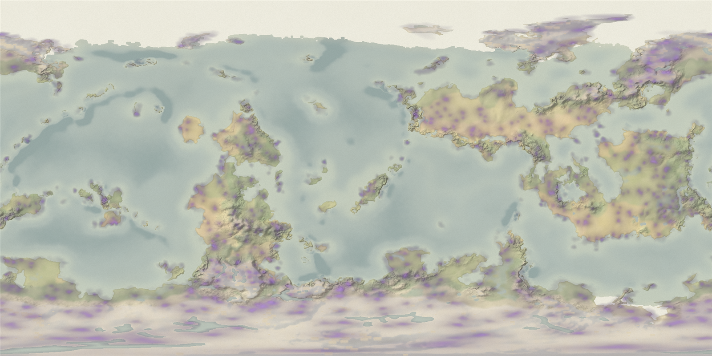
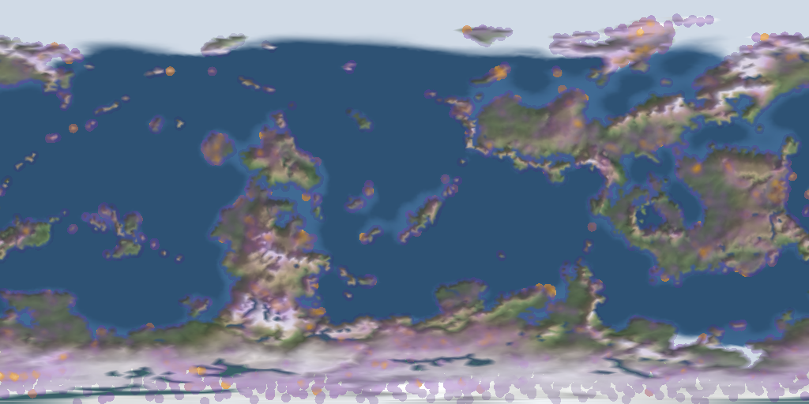
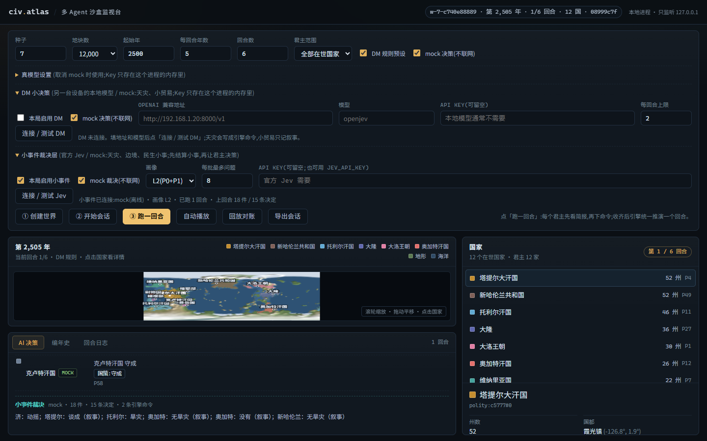

<h1>civ-atlas · 多 Agent 沙盒</h1>

> 给 [civ-atlas](https://github.com/guaner-334/civ-atlas) 的星球历史推演加一层「可被 AI 接管」的沙盒：MCP 工具层、AI 君主回合、小事件裁决层、可配置场与地块级演化、本地浏览器查看器。

[](LICENSE)


[](https://github.com/guaner-334/civ-atlas)



<sub>本页图片均为程序模拟生成的地图，不是真实地图。</sub>

## 这是什么

上游 civ-atlas 是纯前端的世界生成 + 历史推演网站。这个仓库在它之上加了一层**无头、可编排、可 AI 接管**的沙盒：

- 不重写引擎：所有扩展都在编排层，通过「停止推演 → 下命令 → 接着推」的 `play` API 完成。
- 引擎确定性不破：同一世界 + 同一命令史 = 逐字节一致的结果（21 组指纹对账全过）。
- 全程可回放：AI 下的每一道命令都进命令史，`civ_session_verify` 能重推对账。

## 新增了什么

| 模块 | 内容 |
|---|---|
| **MCP 工具层**（`mcp/`） | 零依赖 JSON-RPC stdio 服务，21 个 `civ_*` 工具：建世界、开会话、下单、推演、编年史、导出、回放对账、君主回合、DM 小决策、小事件裁决、场目录 |
| **AI 君主**（`mcp/monarch.ts`） | 每个国家先拿简报，再由 LLM（或 mock）决定命令；每国每回合最多 3 条，编译成引擎命令后统一推演；支持 DeepSeek / 百炼 / 自定义 OpenAI 兼容 |
| **小事件裁决层**（`mcp/petty*.ts`） | 接官方 Jev `POST /api/v1/decisions`；客户端控 token（≤4250）、严格串行优先队列（P0/P1/P2）、超时/背压/熔断/降级，概率交给引擎统一随机流抽样 |
| **DM 小决策与故事** | 天灾/小贸易真写进引擎；`story` 干预让 DM 按剧情写事件，效果只落在城市折损、人口上限、发展、叙事四类 |
| **地形渲染**（`mcp/terrain.ts`） | 直接复用主站的 `gen/raster.ts`、`gen/rasterWindow.ts`、`render/fantasy.ts|realistic.ts` 生成底图、放大块与矢量细节层；零新依赖，PNG 仍由 `mcp/png.ts` 手写编码 |
| **浏览器查看器**（`mcp/viewer.ts`） | 和主站同一个开发服务器（`/sandbox/`）：主站同款地形画法与矢量墨线、放大现算高清块、跨极无限拖动；国家详情/AI 决策/编年史/回合日志/回放对账/导出，含 DM、小事件、场图层与 hover 精确值 |
| **可配置场**（`fieldPlugin.ts`） | 玩家给一份 spec 就能生成一组原生插件表：自己选密度、扩散、衰减、强度，以及影响哪些官方数值（`city.capacity`/`war.odds`/`unrest.add` 等 6 个口） |
| **地块级场** | `unit: "tile"` 时场按世界全部地块逐年演化，出手前聚合成州值再影响引擎；图层内存按地块、存档按 `cell` 层 |
| **官方 .civplugin 加载器**（`plugin-loader.ts`） | 在 MCP 的 CommonJS 产物里用 QuickJS 直装官方推演插件（文件或源码目录，最多 4 个），与内置场并列 |
| **魔力动态场**（`magicPlugin.ts`） | 内置示例插件：魔脉扩散渗流 + 人口耗散，每 50 年一帧，影响城市容量；强度 0 时官方指纹逐字节不变 |
| **君主沙盒四功能** | 首次引导（LLM/Jev 两把 Key 落盘本机）、双开关（LLM 扮演 / Jev 判断独立）、君主角色卡 + 独立记忆 + 高影响命令 Jev 审核 + 玩家/DM 复核、分层提示词（稳定前置）+ 逐州属性 + 渗透情报（第 27 种干预 `intel`，进命令史） |

更多细节在 [`mcp/README.md`](mcp/README.md)。

## 快速开始

需要 Node.js 22+ 与 pnpm。

### 1. 跑原版网站

```bash
pnpm install
pnpm dev          # http://127.0.0.1:5188
```

Windows 下也可以双击根目录的 [`启动.bat`](启动.bat)。

### 2. 构建 MCP 工具层

```bash
# 本机没有 pwsh 可执行文件时用 powershell 调脚本
powershell -NoProfile -ExecutionPolicy Bypass -File mcp/build.ps1
```

构建产物在 `mcp/.build/`，把 MCP 客户端指向 `mcp/.build/mcp/server.js`：

```json
{
  "mcpServers": {
    "civ-atlas": {
      "command": "node",
      "args": ["<仓库路径>/mcp/.build/mcp/server.js"]
    }
  }
}
```

### 3. 跑查看器

```bash
pnpm dev          # http://127.0.0.1:5188
# 沙盒监视台在同一个服务器上:http://127.0.0.1:5188/sandbox/
```

同一个开发服务器下就能打开两份界面:主站在 `/`,沙盒在 `/sandbox/`(首页左下角也有入口)。首次打开 `/sandbox/`(或 `mcp/` 源码有更新)时,开发服务器会自动构建 MCP 层并起一个只监听本机的监视台进程,不用再单开一个 5190。

第一次打开 `/sandbox/` 会先弹一个引导浮层:**LLM(扮演君主)** 与 **Jev(裁决小事件 / 审核高影响命令)** 两把 Key 分开填,都能「测试连接」;不想联网就点「稍后配置」,自动切到 mock。Key 按你的选择存在本机浏览器的 `localStorage`(明文,只在本机),只 POST 给 `127.0.0.1` 上的监视台进程,不进会话日志、不进导出;公用电脑建议直接用 mock。



「参数」抽屉里有两个互不依赖的开关——**LLM 扮演** 与 **Jev 判断**,四种组合都能跑:只开 LLM(君主回合 + 规则审核)、只开 Jev(小事件回合)、两个都开(小事先结算,高影响命令再过 Jev)、两个都关(纯引擎推演)。另有 **玩家 / DM 复核**:打开后「跑一回合」只出方案不推演,可以在面板里逐条取消命令再提交。


监视台的地图现在**和主站同一套渲染管线**,不再另写一份栅格与配色:

- **画法**:顶栏「画法」可选**手绘羊皮纸 / 卫星写实 / 地理图**,另有改造前的沙盒底图作对照。底图由 `src/gen/raster.ts` + `src/render/fantasy.ts|realistic.ts` 在 Node 里直接算出来(这些模块本来就是「纯计算,worker / Node 都能跑」),加了世界时只算一次并缓存。
- **放大分辨率**:底图是 1 倍主图(2048 × 1024)。放大超过 2 倍后按 √2 分档、只重算屏幕上那几块(`src/gen/rasterWindow.ts` 的 `rasterizeWindow`),块坐标锚在球面展开平面上,拖动时缓存仍能复用,越放大越锐利。
- **矢量细节层**:手绘风的海岸墨线、近岸波纹、山/树符号不再烤进位图,而是由 `/api/map/vectors` 送抽稀后的折线与符号,浏览器按**固定 1–1.15px 屏幕线宽**重画——放大到 1200% 也保持细锐,符号按 `g.z` 分级出现、尺寸按 `glyphScale(k)` 收缩(和主站 `render/detail.ts` 一个思路)。跨 180° 经线的线会在另一侧补一份,拖到屏幕边缘也不会断。
- **海岸线跟着瓦片走**:每块放大块由服务端按**自己的倍率**重新追一遍水陆边界(0.5 瓦片像素内,就是边界像素的量化下限),而不是复用 1 倍底图那份——后者放大后会整体偏 3~4 个屏幕像素,线"浮"在岸外。换档瞬间缺块的地方由上一档瓦片放大顶着(只差 √2 倍),不会整片糊掉再突然变清。
- **拖动 / 缩放**:事件合到 `requestAnimationFrame`、海岸线连续描边、符号整帧两条路径、瓦片盖满时不画底图、交互时按像素预算降画布分辨率,松手再恢复满分辨率。
- **跨极回环**:世界东西相连,越过南北极也按球面的真实接法接到另一侧(纬度镜像 + 经度挪半圈),所以**上下左右都能一直拖**;点选国家、hover 数值、国都标注都按同一套变换反算。
- **浮窗式界面**:顶栏、左侧行动栏、参数抽屉、国家面板、日志面板、右下缩放条都是浮在地图上的玻璃卡片,国家面板和日志面板能收起到只剩一条标题。

> 地图渲染复用上游模块时有一个构建期细节:`src/render/labels/fonts.ts` 里有一句 Vite 专属的 `import.meta.env.BASE_URL`,在 CommonJS 产物里是语法错误。`mcp/build-compat.cjs` 会在 tsc 之后把**产物**里的这一句替换掉(幂等,不改上游 `src/`),`mcp/build.ps1` 与 Vite 自动构建都会调用。

也可以单独起监视台(比如不跑主站、或接到别的端口):

```bash
node mcp/.build/mcp/viewer.js --port 5190
# 浏览器打开 http://127.0.0.1:5190
```

查看器的世界/会话在内存里,关掉就没了;日志写在 `mcp/.runs/`(不提交)。

### 4. 一个最小 AI 对局

1. `civ_world_create`（`seed` 必填，`params.cells` 可选）
2. `civ_monarch_setup`（`polities: "all"`，`mock: true` 先不联网）
3. `civ_session_open`（`worldId` + `startYear`）
4. `civ_monarch_round` 反复跑；中途 `civ_state_get` / `civ_session_verify`

想要场：`civ_session_open` 加 `fields`（可带 `"unit": "tile"`）；想要官方插件：加 `plugins`。

## 验证

```bash
# 15 个自检（引擎、协议、君主、press、DM、小事件、场、插件、地块场、君主沙盒四功能、瓦片海岸线）
node mcp/.build/mcp/selftest.js
node mcp/.build/mcp/selftest-protocol.js
node mcp/.build/mcp/selftest-monarch.js
node mcp/.build/mcp/selftest-press.js
node mcp/.build/mcp/selftest-dm.js
node mcp/.build/mcp/selftest-dm-oracle.js
node mcp/.build/mcp/selftest-petty-core.js
node mcp/.build/mcp/selftest-petty-oracle.js
node mcp/.build/mcp/selftest-field.js
node mcp/.build/mcp/selftest-magic.js
node mcp/.build/mcp/selftest-field-plugin.js
node mcp/.build/mcp/selftest-plugin-loader.js
node mcp/.build/mcp/selftest-tile-field.js
node mcp/.build/mcp/selftest-monarch-sandbox.js
node mcp/.build/mcp/selftest-coast.js
```

- 15 组自检全绿（含地块场 30/30、君主沙盒 45/45、瓦片海岸线 18/18）。
- 根 `tsc --noEmit` 与 `examples/plugins` 类型检查均为 0 错误；已发布的插件接口第 1 版未改动。
- 确定性指纹 21/21 一致（含改地形、干预、分段推演等 21 组，2026-11-11）。
- 查看器地图：Playwright 在 `devicePixelRatio` 1 / 1.5 下跑通 建世界 → 开会话 → 跑一回合 → 跨极点选国家 → 100% / 450% / 1200% 缩放 → 四种画法来回切；高清瓦片全部 200、无 400 / 502、无 console 错误，缩回 100% 时不再请求低档瓦片。

## 截图

**君主沙盒**

| 君主角色卡:性格 / 能力 / 自述 / 独立记忆 / 情报 | 回合方案复核:逐条取消命令再提交 |
|---|---|
|  |  |

**场与裁决层**

| 魔力动态场 | 地块级场 |
|---|---|
|  |  |



## 目录

```
mcp/                 无头工具层（MCP 服务、君主、DM、小事件、查看器、场渲染、自检）
src/gen/civ/         引擎与官方推演插件接口（新增 magicPlugin / fieldPlugin / storyEngine 等）
ai-ruler/            「AI 扮演统治者」独立原型（简报 → 决策 → 命令，含 mock）
docs/                开发文档、截图
examples/plugins/    官方格式推演插件示例
多Agent沙盒-改造计划.md  这次改造的设计与分阶段计划
UPSTREAM.md          上游 civ-atlas 原 README
```

## 文档

- [`mcp/README.md`](mcp/README.md)：MCP 工具、AI 君主、DM/小事件、场系统、插件加载器、查看器的详细用法与边界
- [`docs/君主沙盒-四功能可行性报告.md`](docs/君主沙盒-四功能可行性报告.md)：四项功能（引导 / 双开关 / 角色卡 / 提示词与情报）的实现方案、难度评级与风险点
- [`多Agent沙盒-改造计划.md`](多Agent沙盒-改造计划.md)：三阶段改造的目标、约束、验收标准
- [`ai-ruler/README.md`](ai-ruler/README.md)：AI 统治者原型（可先不接 MCP 单独跑）
- [`docs/development.md`](docs/development.md)：上游的引擎开发说明

## 许可与致谢

- 本项目基于 [guaner-334/civ-atlas](https://github.com/guaner-334/civ-atlas)（AGPL-3.0），保留其全部历史与许可证。
- 本仓库的修改同样以 **AGPL-3.0** 发布；如果把它改完挂到网上给别人用，需要按 AGPL 公开修改。
- 引擎、星球生成、历史推演、原网站的所有功劳归上游作者与贡献者；这里新增的是多 Agent 编排、场系统、查看器与工具层。
- 仓库里没有任何真实 API Key：MCP 侧 Key 只从工具参数或环境变量进内存；查看器按需把 Key 存在本机浏览器的 `localStorage`（明文，只在本机），只 POST 给 `127.0.0.1` 的监视台，不进会话日志、不进导出。
